# UniversityExamination
高校考试管理系统 计算机毕业设计
所有源码均本人开发，项目是前后端分离的，所有的项目都具备了完整的业务逻辑，不仅仅局限于基础的增删改查（CRUD）操作，系统亮点众多。

本文注重于计算机毕业设计选题指导，列出题目均有源码， 大家可以去【公众号】(毕业终点站)获取或者加我【qq】(2112698948)提意见(别忘记Star哟)。备注：git

声明：仅用于学习使用，请勿用于任何商业行为！

1.系统非商用，非开源，非无偿。

2.由本人开发，如需源码，请联系以下方式，qq:2112698948。

3.项目有很多，并未全部上传，如果未找到想要的，可直接咨询。
# 高校考试管理系统

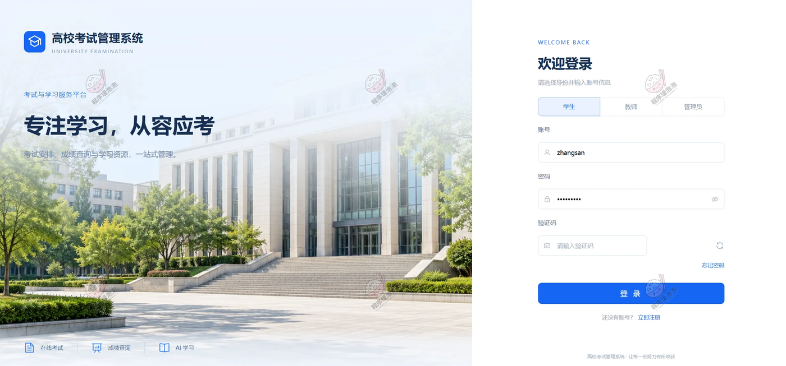

## 一、系统介绍

一套面向高校的在线考试系统，分管理员、教师、学生三个角色。教师建题库、组卷、排考、阅卷、看分析；学生在线上答题、查成绩、刷错题、跟 AI 练题；管理员管账号、班级、课程和全平台考试。

组卷不是随机抓题——按课程、知识点、题型先筛出候选，再按难度和目标值的差距算权重做轮盘赌抽样，抽走即从池里移除，所以既能贴着目标难度，又不会每次出同一套。客观题交卷即算分，单选判断走规范化匹配，多选题按集合比：全对满分、漏选给一半、错选零分。主观题交给 DeepSeek 出评分和批注，教师复核后发布成绩。

### 系统亮点

**① 加权随机组卷算法**
按课程、知识点、题型筛出候选题，根据题目难度与目标难度的距离计算权重，轮盘赌抽样选题，选中后从候选池移除。目标难度能压住，题目又不会年年重复。

**② 客观题答案匹配算法**
单选题、判断题先把答案规范化（去空格、统一大小写、选项归一），再做匹配评分。交卷后客观题分数立刻出来，教师只需要处理主观题。

**③ 多选题集合评分算法**
把选项转成集合比较：完全匹配得满分，非空漏选得一半分，错选不得分。比"全对或全错"更贴近真实考试的给分习惯。

**④ DeepSeek AI 辅助阅卷**
把题目、参考答案、学生作答和分值一起送进模型，返回评分和批注，支持并发处理。教师可以逐题改分、写批注，确认后统一发布成绩。

**⑤ AI 学习全流程**
学生选课程、难度、题型创建学习会话，AI 出题 → 学生作答 → AI 评价，过程中记录答对数，结束会话时生成一份学习总结，回头能看自己哪块弱。

**⑥ 考试过程管理**
答题页每 15 秒保存一次有变化的答案，配倒计时、到点自动交卷;后台还有定时收卷任务和缺考记录，考试结束后的收尾不用人工盯。

**⑦ 错题复习完整链路**
判定为错的题自动同步进个人错题本，带参考答案、解析、错误次数和知识点分布，可以按课程筛，弄懂之后手动移除。

**⑧ ECharts 多角色分析**
管理员看平台考试与成绩概况，教师定位低正确率题目和薄弱知识点，学生看个人成绩趋势和课程表现——同一批考试数据，三个角色看到各自该看的那一面。

### 技术选型

| 层次 | 技术 |
| --- | --- |
| 架构 | B/S、MVC、前后端分离、三角色权限管理 |
| 后端 | Java 17、Spring Boot 3.3.1、Spring MVC、MyBatis-Plus、JWT |
| 数据库 | MySQL |
| 前端 | Vue 3、Vite、Element Plus、Vue Router、Pinia、Axios |
| 图表 | ECharts |
| 文件处理 | Apache POI（题库 Excel 导入导出） |
| AI 能力 | DeepSeek API（主观题阅卷、AI 出题与评价） |

## 二、角色与功能

| 角色 | 主要功能 |
| --- | --- |
| 管理员 | 数据看板、用户管理（封禁/重置密码/导出）、班级与课程管理、全平台考试查看与状态调整、成绩统计与风险考试分析、轮播图/公告/操作日志 |
| 教师 | 教学概览、题库管理（五种题型 + Excel 导入导出）、试卷管理（手动选题 / 自动组卷）、考试管理（关联班级、时长、及格线）、在线阅卷（AI 辅助）、答卷与成绩分析 |
| 学生 | 首页（考试安排、公告、排行榜）、在线考试（答题卡、标记、倒计时、自动保存）、成绩查询（逐题得分与解析）、错题本、学习统计、AI 学习 |

## 三、系统截图

### 学生端

#### 首页

待参加考试、已出成绩、平均分、错题数四个指标直接摆在上面，下面是近期考试安排、系统公告、成绩排行榜和快捷入口。

#### 我的考试

按状态筛考试，进行中的直接进考场，未开始和已结束的分开显示时间和时长。

#### 考试记录

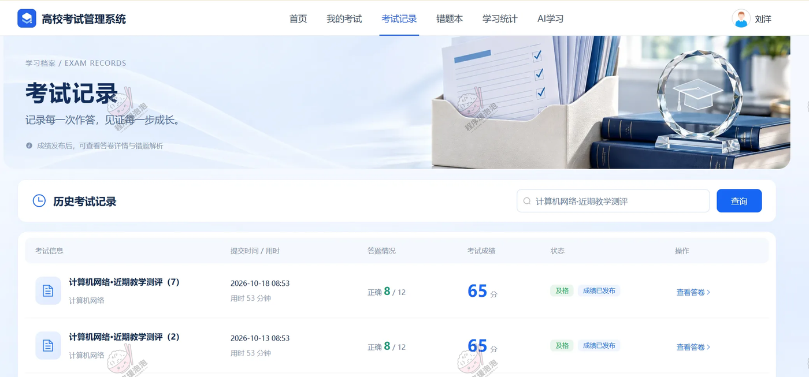

历史考试列表，标注得分、用时和状态，未发布的成绩显示为待发布。

#### 考试记录详情

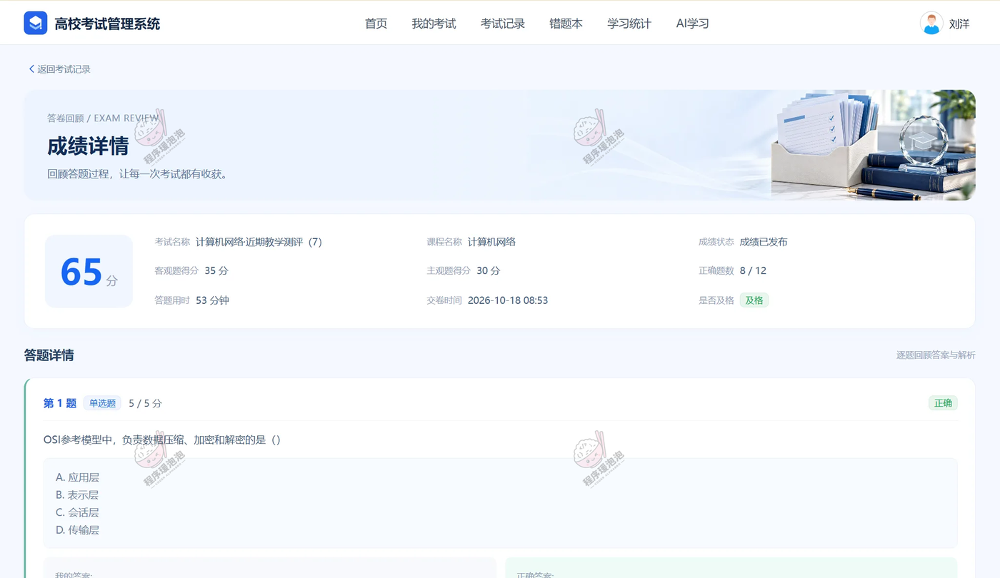

逐题看自己的作答、正确答案、得分和解析，主观题能看到教师批注。

#### 错题本

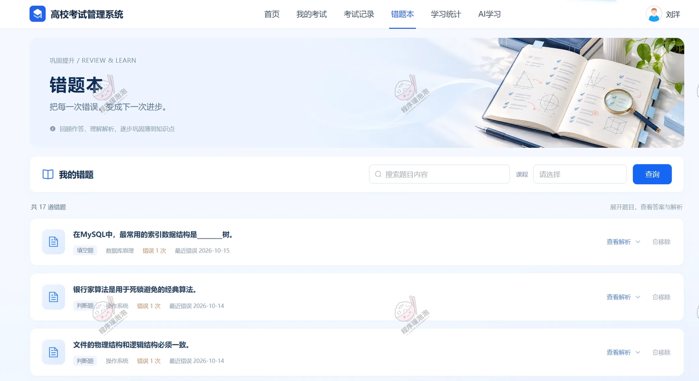

按课程筛选，每题标了错误次数和知识点，展开看解析，掌握后点移除。

#### 学习统计

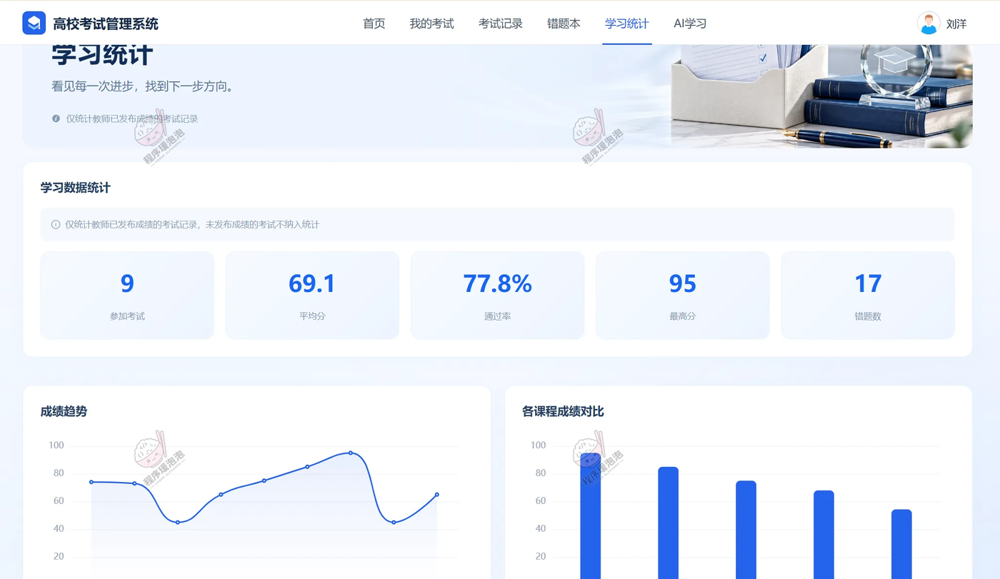

考试次数、平均分、通过率、成绩趋势曲线、各课程成绩对比和错题知识点分布。

#### AI 学习

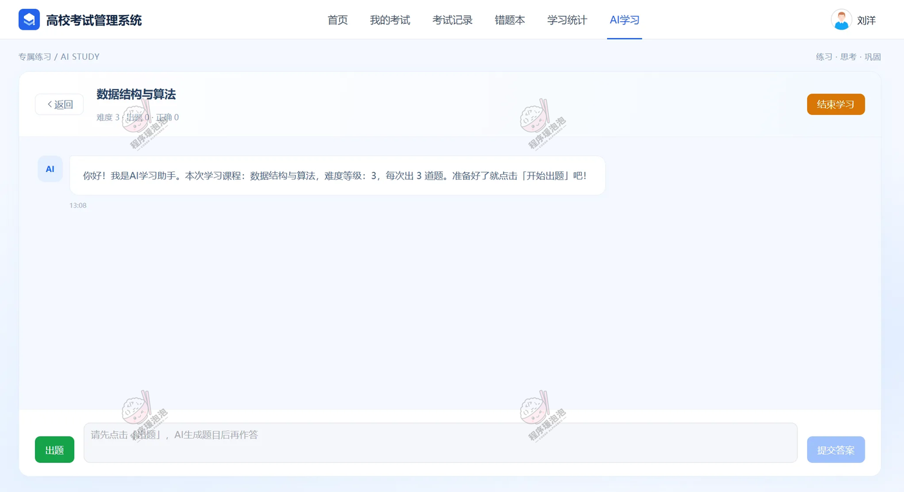

选课程、难度（1-5）、每次出题数量后开始会话，AI 出题 → 提交答案 → 评价反馈，右上角结束学习会生成总结。

### 教师端

#### 教学概览

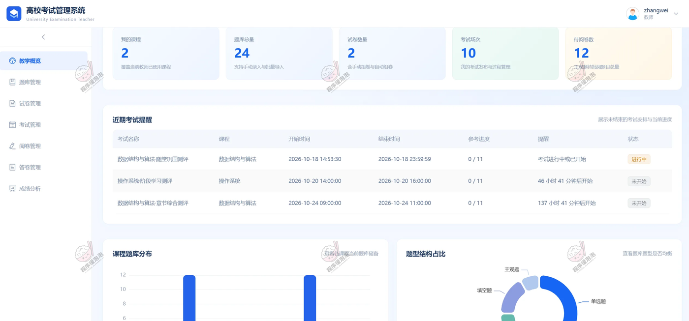

课程题量、题型分布、待批阅数量和考试交卷进度，进来先知道今天要干什么。

#### 题库管理

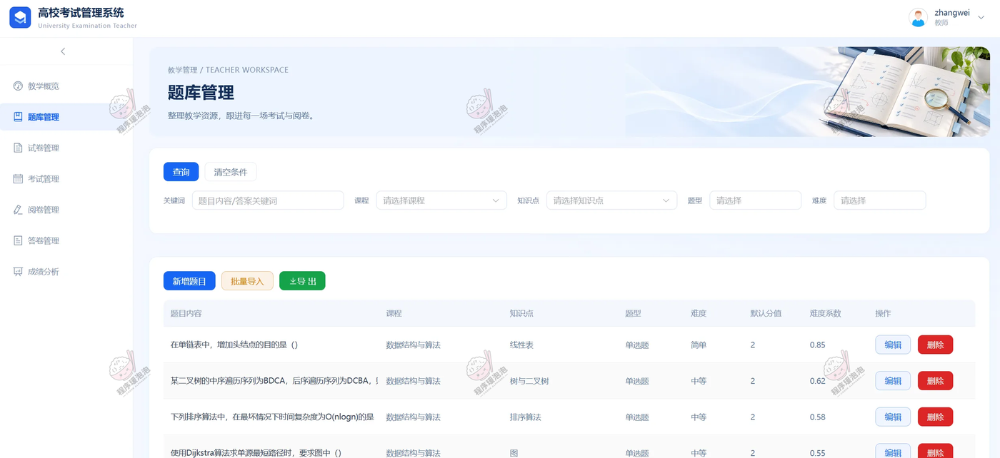

单选、多选、判断、填空、主观五类题统一维护，关联课程和知识点，支持 Excel 批量导入导出。

#### 试卷管理

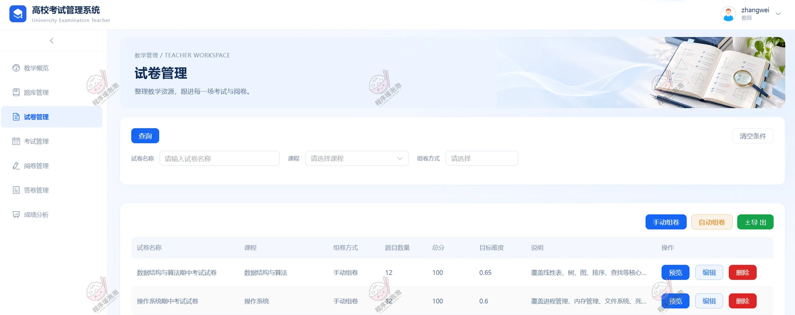

两种组卷方式：手动选题排序设分值，或按题型数量 + 知识点 + 目标难度自动组卷（加权随机算法在这里生效）。

#### 考试管理

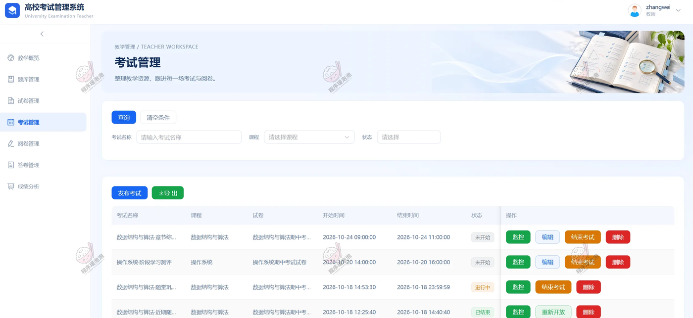

试卷关联班级，设置开考时间、时长、及格线，随时看参考人数和交卷情况，可结束或重新开放。

#### 在线阅卷

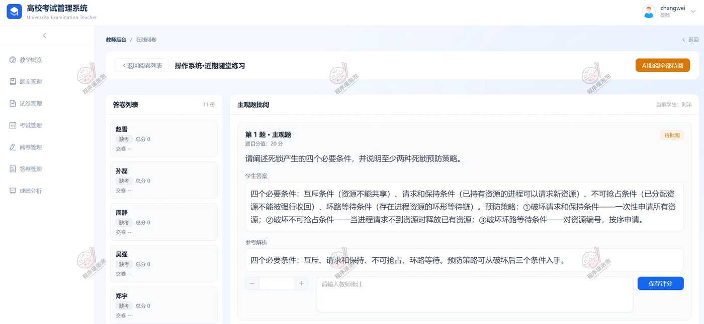

左侧答卷列表，右侧主观题批阅区，上方「AI批阅全部试题」一键跑完，教师逐题复核改分、写批注再发布。

#### 答卷管理

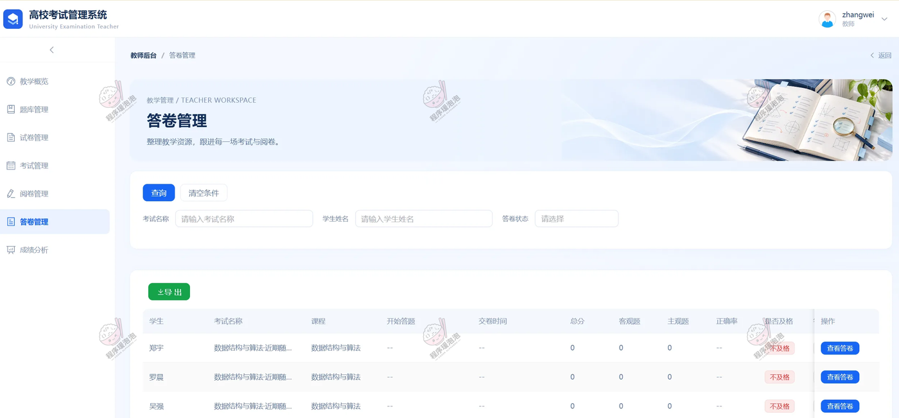

按考试看全部答卷，单个学生的得分、用时、提交状态都列在表里，可导出成绩表。

#### 成绩分析

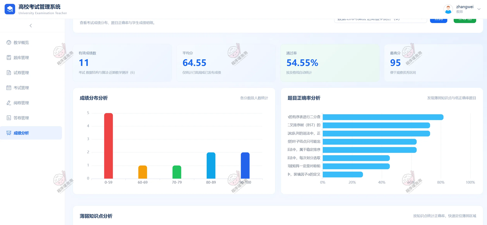

成绩区间分布、题目正确率、知识点正确率三块图表，低正确率题目直接标出来，方便下次课重点讲。

### 管理员端

#### 数据看板

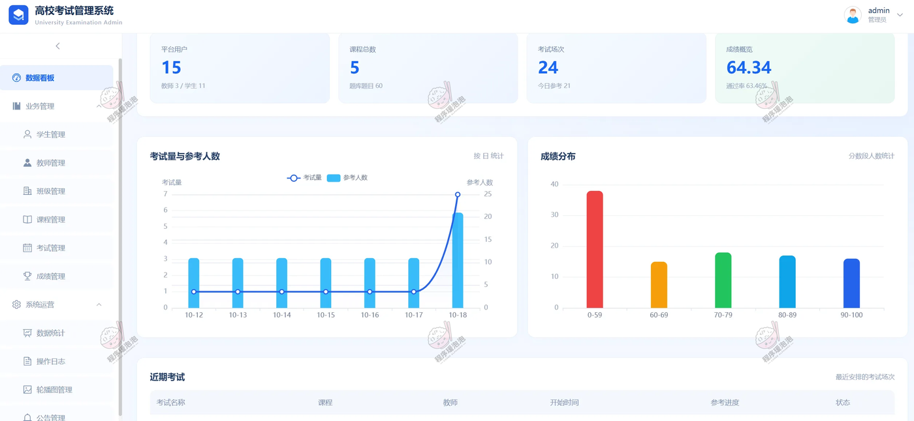

用户、教师、学生、课程、题库、考试六项统计，配参考趋势和成绩分布。

#### 学生管理

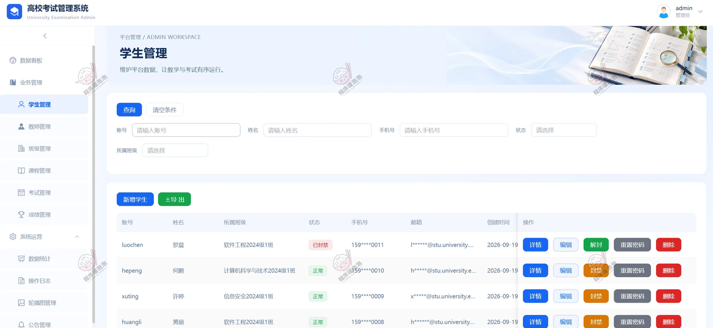

账号维护、详情查看、封禁解封、密码重置，支持按班级和状态筛选、数据导出。

#### 班级管理

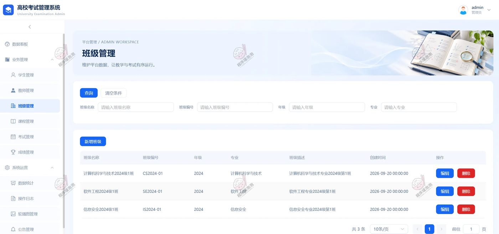

班级增删改查、关联课程与学生，考试推送按班级走。

#### 考试管理

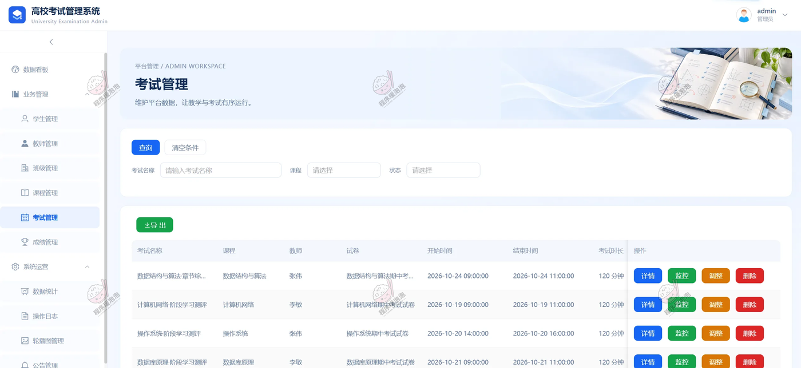

全平台考试一览，按课程、教师、状态筛选，可以手动调整考试状态。

#### 成绩管理

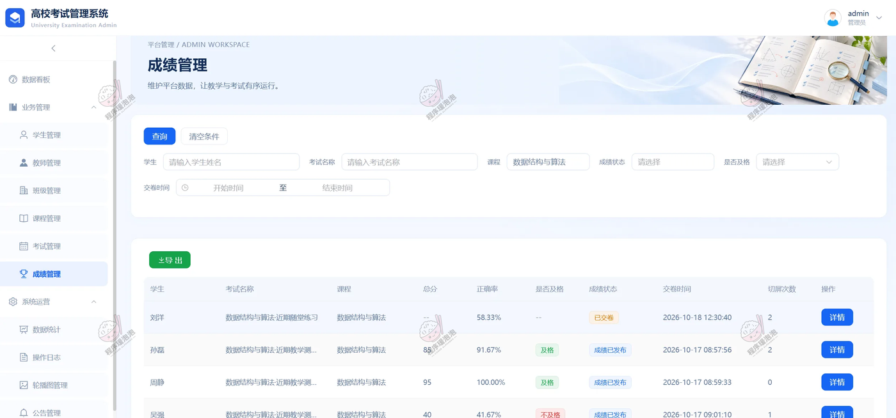

成绩查询与导出，课程平均分、课程及考试通过率、风险考试分析集中在这里。

#### 数据统计

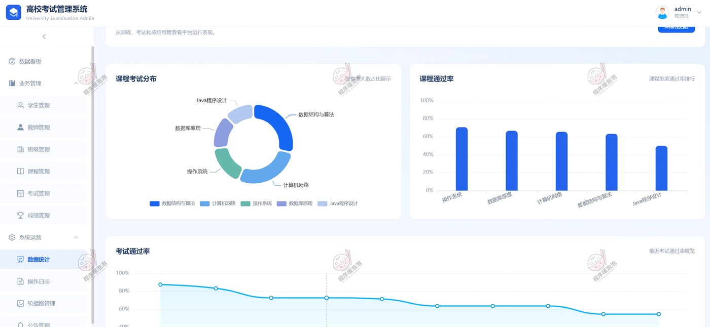

跨课程、跨考试的多维对比图表，看整体教学效果用这一页。

## 四、说明

- 文档展示 21 张截图，需要了解更多，请联系我。
- 系统为 B/S 三端（管理员 / 教师 / 学生），前后端分离，本地部署 Windows + MySQL 即可跑起来。
- 题库支持 Excel 导入导出，批量建题不用一条条录。
